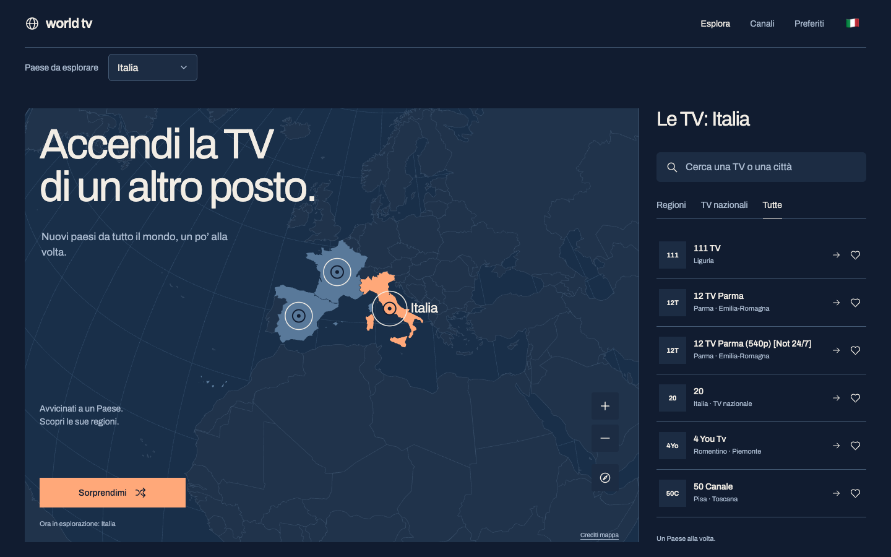
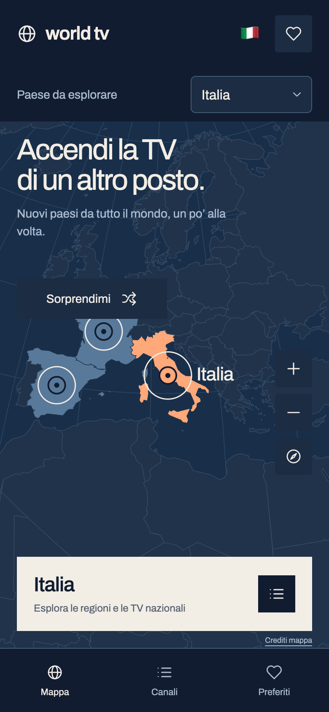

# World TV

**Un atlante interattivo delle televisioni in diretta.** Scegli un Paese sul globo, entra nelle sue regioni e guarda le TV nazionali e locali. È come Radio Garden, ma per la televisione.

**Demo:** [world-tv-flax.vercel.app](https://world-tv-flax.vercel.app)



<p align="center"></p>

## Cosa fa

- **Globo navigabile:** trascinamento, zoom con rotella, pinch e pulsanti, Paesi e regioni cliccabili, pin delle emittenti nella città della loro sede.
- **Catalogo per Paese:** Italia (circa 550 canali), Spagna (circa 250), Germania (circa 110), Brasile (circa 110), Francia (circa 90), Messico (circa 75) e Portogallo (circa 20). TV nazionali separate da quelle regionali e locali, con ricerca per nome o città, preferiti e pulsante "Sorprendimi".
- **Player HLS/DASH** nel browser (hls.js, dash.js, HLS nativo su Safari). Se una fonte non funziona, il player passa da solo a quella successiva. I messaggi d'errore distinguono geoblocco, CORS, DRM e fonte offline.
- **Interfaccia in italiano e inglese**, progettata per desktop e mobile (design system "Orbita").

## Stack

| Ambito | Tecnologie |
| --- | --- |
| Framework | Next.js 16 (App Router), React 19, TypeScript |
| Stili | SCSS Modules con design token, nessuna libreria UI |
| Mappa | d3-geo (proiezione ortografica, GeoJSON regionali con licenza) |
| Video | hls.js, dash.js |
| Test | Playwright con Chrome reale, test Node, ESLint, `tsc` |
| Deploy | Vercel |

## Sviluppo con l'AI

Ho sviluppato il progetto coordinando **agenti AI** (Claude Code e OpenAI Codex), con un metodo pensato per il lavoro in parallelo:

- **Ruoli separati:** ogni agente riceve un incarico scritto e può modificare solo i file di sua competenza. Per esempio uno lavora a un Paese mentre l'altro cura il codice comune, così non ci sono conflitti.
- **Passaggi di consegna e controlli incrociati:** ogni lavoro si chiude con un rapporto (`docs/diagnostics/*-handoff.md`) e viene ricontrollato in modo indipendente dall'altro agente prima della pubblicazione.
- **Ricerca automatizzata:** gli agenti cercano le dirette ufficiali sui siti delle emittenti e la loro sede (contatti, registri delle autorità) e costruiscono un catalogo per ogni Paese.
- **Verifica oggettiva:** nessuna diretta viene dichiarata funzionante perché lo dice l'AI o perché il server risponde HTTP 200. Il runner `npm run test:streams` apre ogni fonte in Chrome con il player del sito e la accetta solo con fotogrammi decodificati, dimensioni video valide e 20 secondi di riproduzione continua.

Regole del progetto: niente restream non ufficiali né URL con token temporanei, e nessun aggiramento di DRM, geoblocco o login. Il sito collega lo spettatore all'emittente e non ritrasmette il video.

## Avvio locale

```bash
nvm use        # Node 22
npm install
npm run dev    # http://localhost:3000
```

Controlli:

```bash
npm run lint
npx tsc --noEmit
node scripts/check-country-packs.mjs   # coerenza di catalogo, geografia e mappe
npm run build
```

## Struttura

```
src/app/              pagine e API (/api/channels, /api/test-results)
src/components/orbita interfaccia: globo, lista, player
src/lib/              cataloghi, geografia, automazione dei test
data/                 pacchetti per Paese: catalogo, geografia, regioni
public/maps/          GeoJSON regionali con i crediti
scripts/              pipeline dei dati e runner dei test in Chrome
docs/                 design, diagnostica, note di sviluppo
```

## Approfondimenti

- [Note di sviluppo](docs/sviluppo.md): runner dei test, catalogo italiano, geografia
- [Come contribuire con un Paese](CONTRIBUTING.md)
- [Design Orbita](docs/design/orbita-implementation.md) e [lingue](docs/design/languages.md)
- Rapporti per Paese: [Spagna](docs/diagnostics/spain-handoff.md), [Francia](docs/diagnostics/france-handoff.md), [Germania](docs/diagnostics/germany-research-coverage.md), [Portogallo](docs/diagnostics/portugal-handoff.md), [Brasile](docs/diagnostics/brazil-research-coverage.md), [Messico](docs/diagnostics/mexico-research-coverage.md)

Le dirette appartengono alle rispettive emittenti, e la loro disponibilità può cambiare nel tempo.
